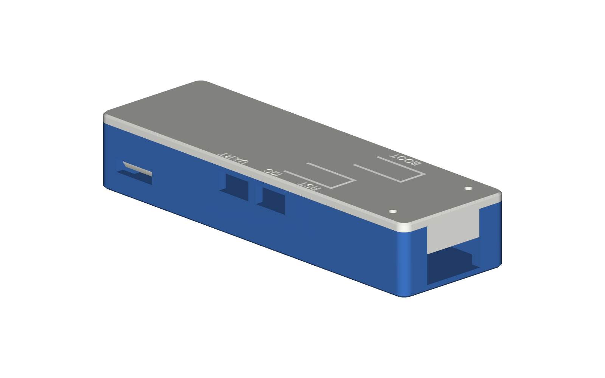

# Dongle case

A two-part snap-fit case for the board, sized for a 0.4 mm nozzle and tested in the model against the board's own 3D parts. It has not been test-printed yet, so treat the first print as a fit check.

## Files

| File | Use |
| --- | --- |
| `dongle-case-base.stl`, `dongle-case-lid.stl` | Ready to slice. Both are already in print orientation. |
| `dongle-case-base.step`, `dongle-case-lid.step` | For editing in CAD. |
| `case.py` | CadQuery source. Every dimension is a named value at the top. Run `python3 case.py` to regenerate the files. |

Outside size is 76.85 x 24.55 x 13.8 mm, not counting the USB plug.

## Features

- **Snap fit.** Two tongues on the lid hook into the USB end of the base, and two hooks at the antenna end click into windows in the side walls. To open, press each hook inward through its window with a small screwdriver and lift.
- **Antenna.** A 6.6 mm hole in the end wall takes a U.FL to SMA bulkhead pigtail (1/4"-36 thread). The 14 mm bay behind the board holds the connector body and the cable loop.
- **Buttons.** RST and BOOT are pressed through spring tabs in the lid.
- **Qwiic / JST-SH connectors.** Both are reachable through windows in the side wall, labelled I2C and UART on the lid.
- **LEDs.** Two 1.6 mm holes sit over the status and power LEDs.
- **Board location.** The board drops onto two pegs that fit its 2.0 mm indexing holes and is held down by four posts under the lid.

## Printing

| Setting | Value |
| --- | --- |
| Nozzle | 0.4 mm |
| Layer height | 0.2 mm (0.16 mm gives cleaner hooks) |
| Walls | 3 |
| Infill | 15 % or more |
| Supports | None |
| Material | PLA or PETG |

The lid prints with its outer face on the bed, so the hooks, posts and button plungers print upward.

The hooks print across the layer lines, which is their weak direction. PETG tolerates this better than PLA. If a hook is too stiff or too loose, change `HOOK_T` or `HOOK_CATCH` in `case.py`. If mating parts are tight, raise `FIT` (0.25 mm by default), and if the board is tight on the pegs, lower `PEG_D`.

## Assembly

1. Push the pigtail's SMA end through the hole from inside and fit its washer and nut.
2. Lower the board onto the two pegs, with the USB plug in its notch.
3. Press the U.FL plug onto the module.
4. Hook the lid's tongues into the USB end, then press the antenna end down until both hooks click.
